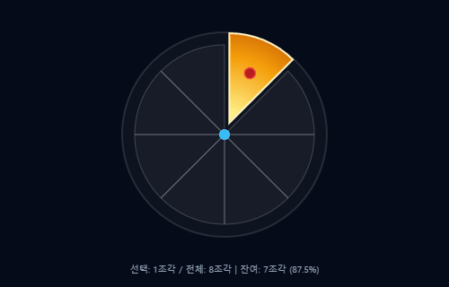
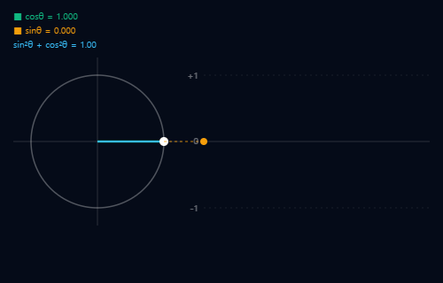
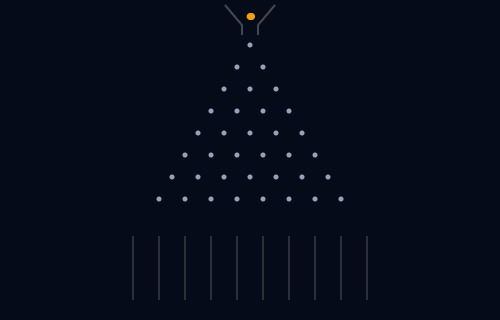
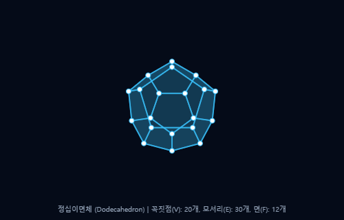
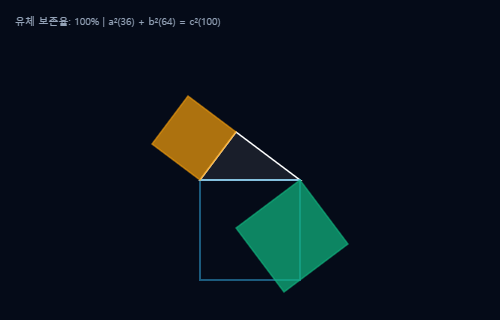

# 📐 직관적 수학·지식 시각화 랩 (Intuitive Math Lab)

> 어려운 수식 대신 눈과 손가락으로 만지는 수학의 아름다움  
> **🌐 라이브 인터랙티브 체험**: [https://kwonflower831-cell.github.io/math-lab/](https://kwonflower831-cell.github.io/math-lab/)

100% 클라이언트 사이드 순수 HTML5 Canvas 엔진으로 구현된 인터랙티브 수학 원리 시각화 교구입니다.  
별도의 설치나 외부 라이브러리 없이 모바일 스마트폰과 PC 브라우저에서 60fps로 매끄럽게 동작합니다.

---

## 🎨 주요 시각화 모듈 (Interactive Modules)

### 1. 🍕 초등 분수 교구 (피자 & 막대 분할 모델)
전체 조각 중 선택된 조각의 비율을 직관적으로 확인하고 기약분수 약분 및 백분율을 실시간으로 탐색합니다.

### 2. ⚪ 단위원과 삼각함수 ($\sin, \cos, \tan$)
단위원을 회전하는 동경 벡터의 수직 높이($\sin$, 주황)와 수평 밑변($\cos$, 청록)이 실시간 파동으로 전개됩니다.

### 3. 🌀 피보나치 수열과 황금 나선 (Golden Spiral)
$1, 1, 2, 3, 5, 8, 13\dots$ 정사각형 타일들이 시계방향으로 증식하며 황금비($\Phi \approx 1.618$) 나선 곡선을 그립니다.

### 4. 🎱 갈톤 보드 (정규분포 핀볼 시뮬레이션)
상단에서 떨어진 구슬들이 핀에 부딪히며 좌우 50% 확률로 튕겨 바닥에 가우스 종형 곡선(중심극한정리)을 형성합니다.

### 5. 📐 3D 플라톤 정다면체 탐색기 (Euler's Formula $V - E + F = 2$)
정사면체, 정육면체, 정팔면체, 정십이면체, 정이십면체를 마우스나 스마트폰 터치 드래그로 360도 자유자재 회전시키며 오일러 불변성을 확인합니다.

### 6. 🌊 피타고라스 정리: 유체 회전 증명 ($a^2 + b^2 = c^2$)
밑변($a^2$)과 높이($b^2$)의 사각형에 채워진 푸른 유체가 빗변의 거대한 사각형($c^2$)으로 남김없이 쏟아져 면적의 보존을 증명합니다.

### 7. 〰️ 푸리에 에피사이클: 회전하는 원들의 파동 합성
서로 다른 주파수와 반지름을 가진 원들의 회전 운동을 중첩해 사각파·톱니파·삼각파를 실시간으로 합성합니다.

### 8. 🎢 최속강하선 (Brachistochrone & 사이클로이드 경주)
두 지점을 잇는 최단 거리는 직선이지만, 중력 하에서 가장 빠르게 도달하는 곡선은 굴러가는 바퀴가 그리는 **사이클로이드(Cycloid)**임을 실시간 구슬 경주로 증명합니다.

### 9. 🚪 몬티 홀의 역설 (Monty Hall Paradox 확률 실험기)
3개의 문 중 염소가 든 문이 하나 열렸을 때, 선택을 바꾸면 당첨 확률이 33.3%(1/3)에서 66.7%(2/3)로 2배가 되는 조건부 확률을 고속 시뮬레이션으로 검증합니다.

### 10. 🌿 프랙탈과 자기유사성 (Fractal Tree & 시어핀스키 삼각형)
세대(Depth)와 가지 각도(Angle) 슬라이더를 조절하며 재귀 공식 하나로 무한한 자연의 구조가 피어나는 자기유사성 기하학을 탐색합니다.

### 11. 🎯 몬테카를로 원주율($\pi$) 추정 (Monte Carlo Rain)
정사각형에 무작위 빗방울 표본을 수만 개 투하하여 원 내부에 들어간 점의 비율($4 \times N_{\text{in}} / N_{\text{total}}$)만으로 원주율 $\pi \approx 3.14159\dots$에 수렴하는 과정을 관찰합니다.

### 12. ✒️ 베지에 곡선과 드 카스텔조 알고리즘 (Bézier Curve & De Casteljau)
4개의 제어점($P_0 \sim P_3$)을 마우스나 터치로 직접 드래그하며 선형 보간(Lerp)의 반복만으로 매끄러운 3차 곡선이 그려지는 원리를 체험합니다.

---

## 🚀 기술 스택 & 특징
- **Pure Web Standards**: HTML5, Canvas 2D API, CSS3 Glassmorphism
- **Zero Dependencies**: Three.js, React, Tailwind 등 외부 번들 없이 단 1개의 독립형 HTML 파일로 작동
- **Mobile Touch Ready**: 스마트폰 터치 제스처(`touchmove`)를 통한 3D 회전 제어
- **Ultra Lightweight**: 전 모듈을 포함한 단일 파일 용량 45KB 미만
